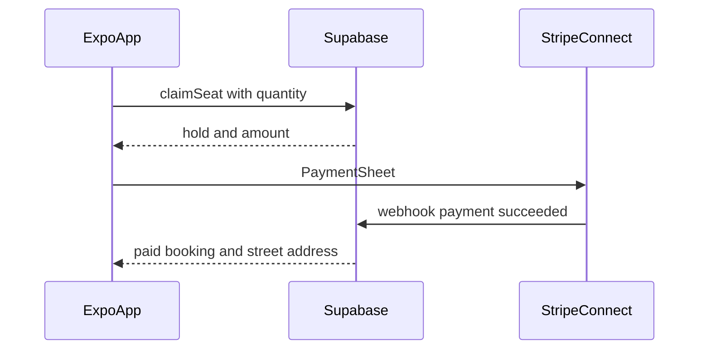

# ADR 0001: Local dinner matching

- Status: Accepted for the product direction. The current build is a local demo, described under Demo.
- Date: 2026-11-11
- Scope: v1 architecture for **big-dinner**

## Demo

The app in this repo is a phone-shaped web demo on local Postgres. It is here to prove the mechanics: a host cap, a short seat hold, a simulated chip-in, a cancellation that gives the seat back, and a street address that stays hidden until a seat is paid. Supabase and Stripe are not part of this demo. The database is embedded Postgres (PGlite), stored in the local `data/` directory.

## Context

big-dinner matches a host who will cook at home with guests who want a seat at that table. Dinners are local and short-notice. Each dinner has a hard guest cap and a price per seat. Guests pay in the app. The product exists so a shared home meal can cost less than a restaurant and so a small group of people can eat together.

Strangers meet inside a private home, and the app holds their money. Those two facts decide the architecture:

- The phone app must not contain Stripe secret keys, and it must not receive a host’s street address before a seat is paid.
- Two guests can try to take the last seats at the same time. Capacity has to be enforced in one database transaction, not in the client.
- A cancelled seat has to release both the money and the cap.
- Food-safety and marketplace rules differ by city. v1 launches in one city and one currency, configured at deploy time. This record does not design a legal-compliance product. It does require a host disclaimer and an 18+ confirmation.

## Decision

v1 is one TypeScript phone app on the current stable Expo SDK, with Supabase as the system of record and Stripe Connect Express as the payment processor.

### Client

One Expo codebase ships to iOS and Android. Navigation uses Expo Router. Push uses Expo Notifications.

Discovery is a list. The device sends its current location with the query and does not store that point on the server. The list returns published dinners whose `starts_at` is between now and 72 hours from now, sorted by distance from that point to the dinner’s public point. Dinners with seats left are the default filter. A map is out of v1. After payment, the address is shown as text the guest can open in the platform maps app.

Screens in v1:

- Profile, including the 18+ confirmation and the host’s home address
- Create and publish a dinner
- Nearby list and dinner detail
- Pay for one or more seats
- Host Stripe Connect onboarding
- My dinners (hosting and attending)
- Cancel a seat or a dinner, with refund
- Dinner chat
- A rating after the dinner

The client stores the Supabase session. It does not cache street addresses or exact pins in durable storage.

### Backend

Supabase provides phone OTP auth, Postgres, Row Level Security, Realtime, and Edge Functions.

big-dinner uses a new Supabase account and a new empty project. It does not use the database already connected on this machine: organization Alumni (`dvhmxfijnmoxcygpnpht`), project ALUMNI (`tjtnfeoleptghzdrvzgw`, `db.tjtnfeoleptghzdrvzgw.supabase.co`). That project's host, database password, service-role key, and publishable key stay unused. Stripe is a new platform account as well. Keys for both live only in this repo's environment, created after the new accounts exist.

Phone OTP is required before a person can browse or publish. A profile row is created from `auth.users`. The profile records `age_confirmed_at`. Browse and publish stay closed until that timestamp is set. There is no government ID check in v1.

Edge Functions are the only place that calls Stripe with the secret key. Postgres functions enforce capacity and authorization. The client calls those functions through Supabase RPC or through an Edge Function. It never talks to the Stripe secret API.

PostGIS is enabled. Distance and “inside the launch city” checks use `geography`.

### Payments

A home meal is a real-world service. Stripe Connect Express charges the guest and later pays the host. Apple and Google in-app purchase are for digital goods and are not the processor for this product.

Money movement is separate charges and transfers:

1. At booking, the platform creates a PaymentIntent for `price_cents * quantity` in the launch currency and confirms it through the Stripe PaymentSheet.
2. The PaymentIntent has no `transfer_data.destination`. Funds stay on the platform balance until the dinner is over.
3. Each booking stores `application_fee_cents`. At launch that value is 0. The column and the transfer math stay in place so a later fee does not require a new charge flow.
4. After the dinner completes, one Transfer is sent to the host’s Connect account for the sum of `amount_cents - refunded_cents - application_fee_cents` across that dinner’s paid bookings.

A guest who cancels before `cancellation_cutoff_at` receives a full refund of that booking. The seats return to the cap. A cancellation after the cutoff does not refund. If the host cancels the dinner, every paid booking is refunded in full.

The host cannot publish until their Express account reports `charges_enabled`. Onboarding is an Account Link created by an Edge Function. `account.updated` writes the resulting state onto the profile. The Connect platform country is chosen to match the single launch market and is fixed before any UI work. `stripe_customer_id` on the profile lets a returning guest reuse a payment method.

Launch configuration is a single `platform_settings` row: launch city boundary, currency, application fee (0), and the platform seat ceiling.

### Matching and seat holds

The host publishes a dinner. The guest claims seats. v1 has no swipe, no ranking score, and no two-sided matching.

A booking has a `quantity`. One account may pay for more than one seat (themselves plus people they bring). The host cannot book their own dinner.

`max_seats` is chosen by the host and is the hard cap for that dinner. The platform rejects a cap below 4 or above 16, so a listing stays a home dinner. Price per seat must meet Stripe’s minimum charge for the launch currency. The host may only publish a start time inside the next 72 hours.

`claim_seat(dinner_id, quantity, idempotency_key)` runs in Postgres and is the only writer that consumes seats:

1. Require an authenticated user with `age_confirmed_at` set.
2. Reject a reused idempotency key that already belongs to that guest; return the existing booking instead of inserting another.
3. Lock the dinner row with `FOR UPDATE`.
4. Require status `published`, a start time in the future, and a host other than the caller.
5. Seats taken are the sum of `quantity` on bookings in `hold` (unexpired) or `paid` for that dinner.
6. If seats taken plus the requested quantity exceed `max_seats`, the function fails and leaves the dinner unchanged.
7. Otherwise insert a booking with status `hold`, `hold_expires_at` ten minutes ahead, and `amount_cents = price_cents * quantity`.

The client then calls the `create-booking-payment` Edge Function with that booking id. The function checks the hold, creates the PaymentIntent with an idempotency key derived from the booking id, and returns only what PaymentSheet needs (client secret, customer id, ephemeral key).

Stripe webhooks are the source of truth for money:

- `payment_intent.succeeded` marks the booking `paid` when the dinner still has room for that quantity, counting other `paid` bookings and unexpired holds except this one.
- If the payment succeeded but the cap would be exceeded (the hold already expired and someone else paid), the function refunds immediately and sets the booking to `refunded`.
- `payment_intent.payment_failed` leaves the hold in place until it expires.
- A scheduled job expires holds whose `hold_expires_at` has passed and cancels a PaymentIntent that is still incomplete.

Fullness is derived. A dinner stays `published` when the cap is reached, and it accepts new claims again if a hold expires or a seat is refunded. The list can hide full dinners by default.

Completion and payout: the dinner becomes `completed` when the host marks it complete, or automatically four hours after `starts_at`. The payout job then creates at most one Transfer per dinner. `payouts.dinner_id` is unique. A retry that finds an existing Stripe transfer id does not create a second transfer.

Default cancellation cutoff is two hours before `starts_at`. The host may move it earlier. They may not place it later than two hours before the start.

### Privacy and trust

The public dinner row stores a neighborhood label and a fuzzed point. The exact pin and the street address live in `dinner_locations`, which is a different table so Row Level Security can refuse the row entirely.

The fuzzed point is the exact point snapped to a 0.005 degree grid (about 500 meters). The same home always produces the same public pin, and the pin is not the door. Distance sorting uses this public point. The guest’s own GPS point is a query parameter only.

Publishing copies the host’s saved home onto `dinner_locations` and writes the neighborhood label plus the fuzzed point onto the public dinner. v1 dinners happen at that saved home. A later dinner uses the profile address as it is at publish time. Past dinners keep the snapshot they were published with.

The street address and exact pin are readable by the host, and by a guest with a `paid` booking for that dinner. Discover, detail, and any realtime payload built from the public dinner omit both.

Chat is a Realtime channel of `messages` for one dinner. Select and insert are allowed for the host and for guests with a `paid` booking.

After the dinner is `completed`, a host or a paid guest may rate another participant of that dinner. One review per reviewer, reviewee, and dinner. Ratings are integers from 1 to 5. A person does not rate themselves.

Any signed-in user may file a report against a user or a dinner. A block is a pair of user ids. A blocked pair does not see each other’s dinners, and they cannot message each other.

Signup collects a phone number through OTP and an explicit 18+ confirmation. v1 does not verify a government ID.

### Data model

`profiles`

- `id` — same as `auth.users.id`
- `display_name`
- `phone_verified` — true once phone OTP has succeeded
- `age_confirmed_at`
- `stripe_account_id` — Connect Express account, hosts only
- `stripe_customer_id` — platform Customer, for PaymentSheet
- `home_geog` — private
- `address_line` — private
- `neighborhood_label`
- `created_at`

`dinners`

- `id`, `host_id`, `title`, `menu`
- `starts_at`, `price_cents`, `currency`
- `max_seats`, `status` — `draft`, `published`, `completed`, `cancelled`
- `cancellation_cutoff_at`
- `neighborhood_label`, `public_geog`
- `created_at`

`dinner_locations`

- `dinner_id` — primary key
- `address_line`, `exact_geog`

`bookings`

- `id`, `dinner_id`, `guest_id`, `quantity`
- `status` — `hold`, `paid`, `cancelled`, `refunded`, `expired`
- `amount_cents`, `application_fee_cents`, `refunded_cents`
- `stripe_payment_intent_id`, `stripe_refund_id`
- `idempotency_key` — unique together with `guest_id`
- `hold_expires_at`, `created_at`

`payouts`

- `id`, `dinner_id` unique, `stripe_transfer_id`
- `amount_cents`, `currency`, `status` — `pending`, `paid`, `failed`

`messages`

- `id`, `dinner_id`, `sender_id`, `body`, `created_at`

`reviews`

- `id`, `dinner_id`, `reviewer_id`, `reviewee_id`
- `rating`, optional `body`
- unique (`dinner_id`, `reviewer_id`, `reviewee_id`)

`reports`

- `id`, `reporter_id`, optional `dinner_id`, optional `reported_user_id`, `reason`, `created_at`

`blocks`

- primary key (`blocker_id`, `blocked_id`)

`push_tokens`

- `user_id`, `expo_push_token`, `platform`
- unique token

`stripe_events`

- `id` — Stripe event id, primary key
- `type`, `received_at`

`platform_settings`

- single row: city boundary (`geography`), `currency`, `application_fee_bps` (0), `min_seats` (4), `max_seats` (16)

Indexes: GiST on `dinners.public_geog` and on the city boundary; btree on `dinners.starts_at` and `dinners.status`; btree on `bookings.dinner_id, status`; partial index on `bookings.hold_expires_at` where status is `hold`.

### Row Level Security

Signed-in users can read a `published` dinner’s public columns. The host can also read their `draft` rows. Inserts and updates on `dinners` are limited to the host, and publishing goes through a function that checks Connect, age, the 72-hour window, the seat ceiling, and the city boundary.

`dinner_locations` select is allowed when `auth.uid()` is the host or when a `paid` booking exists for `auth.uid()` on that dinner. There is no policy that grants this table to all signed-in users.

`messages` select and insert use the same participant check. Realtime subscriptions inherit it.

`bookings` are visible to the guest who owns them and to the dinner’s host. Inserts from the client are denied; `claim_seat` is a `security definer` function and is the only insert path. Status changes to `paid`, `expired`, `cancelled`, and `refunded` happen in functions and webhook handlers, not by a guest updating the row.

`reviews` can be inserted only by a participant, only after `completed`, and only about another participant. `reports` are insert-only for the reporter. `blocks` are readable and writable by the blocker. `stripe_events`, `payouts`, and `platform_settings` are not granted to the client role.

### Services

| Piece | Role |
| --- | --- |
| `claim_seat` | Postgres. Lock the dinner, insert the hold, or return the idempotent booking. |
| `create-booking-payment` | Edge Function. Create the PaymentIntent for an unexpired hold. |
| `stripe-webhook` | Edge Function. Idempotent on `stripe_events.id`. Marks paid, refunds an over-cap success, records account and transfer state. |
| `connect-onboarding-link` | Edge Function. Create the Express account if needed and return an Account Link. |
| `cancel-booking` / `cancel-dinner` | Postgres plus Stripe refund. Release seats only after the refund is accepted. |
| `release-expired-holds` | Scheduled. Expire holds past ten minutes and cancel incomplete PaymentIntents. |
| `complete-dinner-payouts` | Scheduled. Complete due dinners and create the one Transfer. |

Push notifications (booking paid, reminder, cancellation, new chat message, payout) are sent from these functions through the Expo push API, using `push_tokens`.

### v1 boundary

In v1: profile, create dinner, nearby list, dinner detail, pay for seats, host Connect onboarding, my dinners, cancellation and refund, group chat, and a simple rating.

Out of v1: a map, a waitlist, more than one city, government ID verification, dynamic pricing, and a platform fee above zero.

Menu text is how the host describes the food, including anything guests should know about ingredients. Structured dietary filters are out of v1.

## Consequences

- Seat integrity and money integrity share one path. A client bug cannot oversell a dinner or mark a seat paid.
- Hosts receive money after the meal, so a refund before the cutoff does not have to be pulled back from a bank payout. The platform balance must be able to cover refunds until each dinner’s transfer runs.
- Address privacy depends on `dinner_locations` staying off the public table and off realtime. A view or a query that joins it into the public list would undo this decision.
- Trust in v1 is phone verification, a payment identity at Stripe, ratings, reports, and blocks. It is not an identity-document check. People can still misrepresent themselves.
- The host confirms a short disclaimer at publish: they are cooking at home for a private dinner, and local rules about serving food may apply. The product does not license kitchens or inspect meals.
- Webhook handlers must answer 200 after recording an event id, and a repeated delivery must not double-refund, double-pay, or double-transfer.
- The work that has to be correct before any UI is built is the Connect country and onboarding state, webhook idempotency, and `claim_seat`.
- Provisioning waits on a Supabase login that is not the Alumni account. The current MCP session can only see that account, and it cannot create a second login.

## Alternatives considered

**Flutter, a native iOS-only app, or a mobile web app.** v1 needs one codebase on both phone platforms, plus PaymentSheet, push, and a signed-in session. Expo is that codebase. A PWA would still need the same backend and would be a weaker fit for push and the payment sheet. A single native platform would leave the other phone for a later rewrite.

**A custom API on Vercel or Cloudflare as the source of truth.** Auth, geospatial queries, realtime seat counts, and row-level address rules are Supabase’s job. Edge Functions still own every Stripe call. Moving the system of record to a second API would duplicate those controls.

**Guests pay the host outside the app, or the app charges with no refund path.** Chip-in is in-app. A cancelled seat has to return the money and the cap together. Cash or a bank transfer outside the app cannot do that, and a charge with no refund leaves the cap and the guest’s money out of sync.

**Put the street address on the public dinner row.** The listing is visible before anyone has paid. A column hide in the client is not a boundary. A separate table with its own policy is.

**Destination charges that transfer to the host at payment time.** That pays the host before the cancellation window closes and turns every refund into a reversal. Separate charges and transfers keep the refund on the platform balance.

**Authorize now and capture on the day of the dinner.** Impromptu dinners are short, and a capture failure at the door leaves the host with food and an unpaid seat. Charging at booking is the hold that makes the cap real. The ten-minute `hold` status covers the gap while PaymentSheet is open.

**Swipe or score-based matching.** The host already declared the cap, the time, and the price. The guest’s action is to take a seat or leave it. A ranking layer does not change that transaction.
